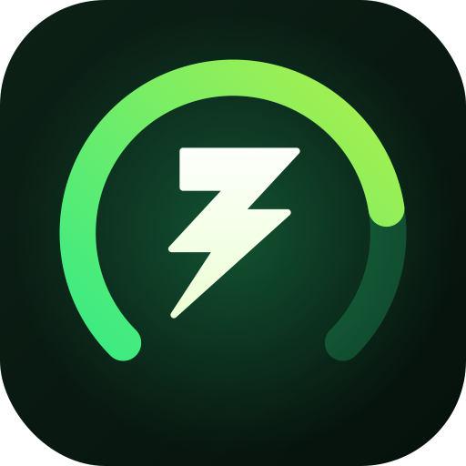
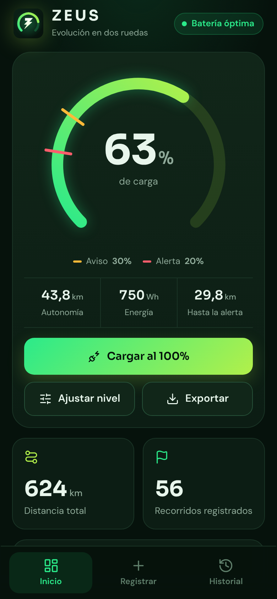
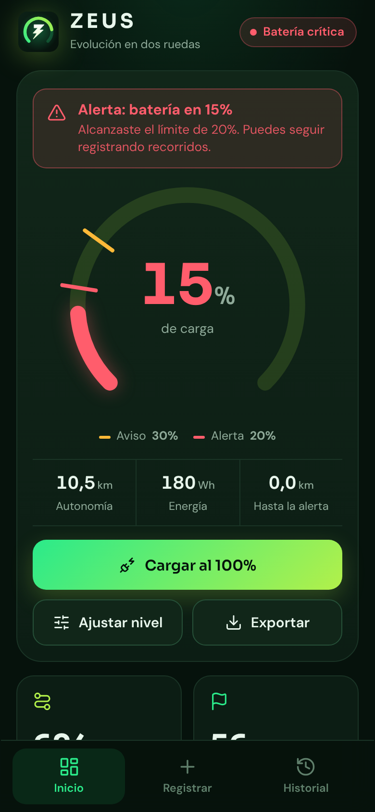
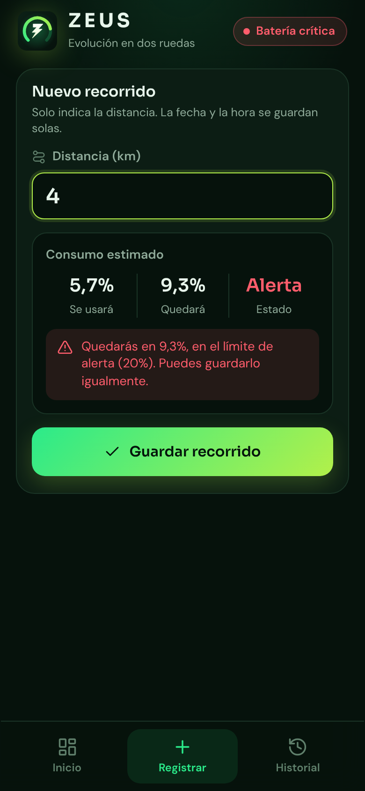
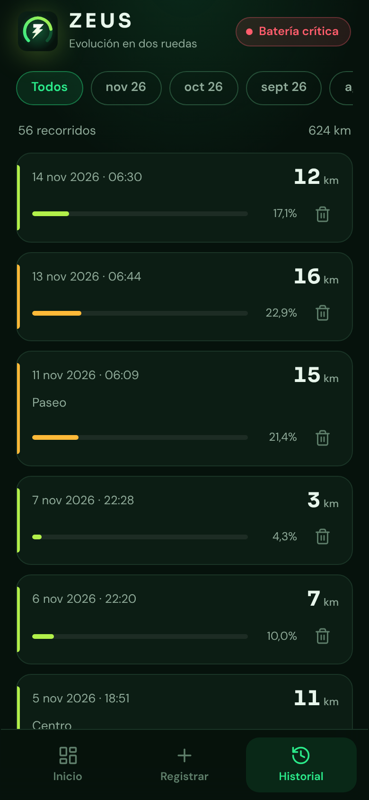
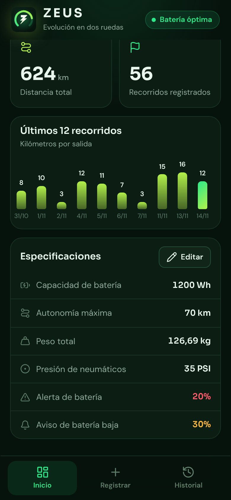

<p align="center">
  
</p>

<h1 align="center">ZEUS</h1>
<p align="center"><b>Evolución en dos ruedas</b><br>Control de batería y recorridos para tu vehículo eléctrico.</p>

<p align="center">
  
  
  
  
</p>

<p align="center">
  
  
  
  
  
</p>

## ¿Qué es?

ZEUS es una aplicación web progresiva (PWA) para llevar el control de la batería de una moto, bici o scooter eléctrico. Registras cada recorrido, ZEUS descuenta la energía usada y te avisa cuando la carga está baja. Todo funciona en el teléfono, sin cuentas ni servidores.

## Funciones

- **Medidor de carga** con autonomía restante, energía disponible (Wh) y kilómetros que faltan para llegar a la alerta.
- **Alertas configurables.** Cuando la batería llega al límite de alerta (20 % por defecto) o baja de él, ZEUS muestra un aviso, cambia de color y vibra. **Nunca bloquea nada**: puedes fijar cualquier nivel, registrar recorridos que lo atraviesen o poner el límite donde quieras, incluso en 5 % o en 0 %.
- **Registro en un paso:** solo escribes la distancia. La fecha y la hora se guardan automáticamente, con vista previa del consumo antes de guardar.
- **Historial** filtrable por mes, con notas y eliminación individual.
- **Exportar e importar** respaldos en JSON.
- **Funciona sin conexión** (service worker) y se instala como app. Fuentes e iconos van incluidos, sin CDN.

## Probarla

No hay paso de compilación. Es HTML, CSS y JavaScript.

```bash
git clone https://github.com/<tu-usuario>/zeus.git
cd zeus
python3 -m http.server 8000      # o: npx serve
# abre http://localhost:8000
```

> El service worker y la instalación como app requieren `http://localhost` o `https://`. Si abres `index.html` directamente (`file://`) la app funciona, pero sin modo offline ni instalación.

Para ver datos de ejemplo, ve a **Historial → Importar** y elige `examples/zeus-sample-data.json`.

> **Historial inicial.** La primera vez que se abre la app en un dispositivo o dirección nuevos, si no hay recorridos guardados, carga `data/historial-inicial.json`. Después los datos viven en el navegador y nunca se vuelven a sobrescribir. Si no quieres incluir tu historial en un repositorio público, borra esa carpeta `data/` (y la línea correspondiente en `sw.js`) y usa **Importar** con tu respaldo.

## Publicarla en GitHub Pages

1. Sube el repositorio a GitHub.
2. En **Settings → Pages**, elige la rama `main` y la carpeta `/ (root)`.
3. Abre `https://<tu-usuario>.github.io/zeus/` en el teléfono.

## Instalarla en el celular (Android / Samsung)

Abre la dirección de Pages en Chrome o Samsung Internet y elige **Instalar app** (o **Añadir a pantalla de inicio**). El icono de ZEUS aparecerá en la pantalla de inicio y en el cajón de aplicaciones.

¿Prefieres un proyecto Android nativo o un APK? Las instrucciones y los recursos del icono (adaptive icon, icono temático de One UI, PNG por densidad) están en [`docs/ANDROID_ICON.md`](docs/ANDROID_ICON.md).

## Datos y privacidad

Todo se guarda en el `localStorage` del navegador de tu dispositivo, y la app le pide al navegador que lo conserve (`navigator.storage.persist`). Nada se envía a ningún servidor. Actualizar la app no borra el historial; sí lo hacen borrar los datos del sitio o desinstalarla, así que exporta respaldos de vez en cuando.

Ojo: los datos viven **por dirección**. `localhost`, un archivo abierto con `file://` y `usuario.github.io` son almacenes distintos, por eso un historial guardado en uno no aparece en otro. Para pasarlo, usa **Exportar** y **Importar**.

**Formato del respaldo** (`zeus-AAAA-MM-DD.json`):

```json
{
  "especificaciones": {
    "capacidadBateria": 1200, "autonomiaMaxima": 70, "pesoTotal": 126.69,
    "presionNeumaticos": "35 PSI", "bateriaMinima": 20, "bateriaAdvertencia": 30
  },
  "recorridos": [
    { "fecha": "2026-11-14T06:30", "km": 12, "bateriaUsada": 17.143, "notas": "Trabajo" }
  ],
  "bateriaActual": 62.5,
  "odometroTotal": 624
}
```

Los respaldos de versiones anteriores (que incluían campos extra por recorrido) se importan sin problema; esos campos simplemente se ignoran.

## Cómo se calcula el consumo

```
% usado = km recorridos ÷ autonomía máxima × 100
```

Con 70 km de autonomía, cada kilómetro consume ≈ 1,43 % de batería. Puedes cambiar la autonomía y la capacidad en **Inicio → Especificaciones → Editar**.

## Estructura

```
zeus/
├── index.html              App completa (HTML + CSS + JS)
├── sw.js                   Service worker (modo offline)
├── manifest.webmanifest    Metadatos de instalación
├── assets/
│   ├── fonts/              Sora y DM Sans (variables, latin)
│   └── icons/              Logo, favicon e iconos PWA (any + maskable)
├── android/                Recursos de icono para proyectos Android
│   └── res/                drawable/ · mipmap-*/ · mipmap-anydpi-v26/
├── docs/
│   ├── ANDROID_ICON.md     Guía de integración del icono
│   └── screenshots/
├── data/                   Historial inicial (se carga solo la primera vez)
├── examples/               Datos de ejemplo
└── tools/make_icons.py     Regenera todos los iconos desde una sola definición
```

## Identidad visual

El logo combina un medidor de carga abierto (el anillo) con un rayo en forma de **Z**, la inicial de Zeus. El arco lleno al 80 % comunica el nivel de batería de un vistazo, y el degradado esmeralda → lima da la identidad verde.

| Color | Hex | Uso |
|---|---|---|
| Verde bosque | `#06120C` | Fondo |
| Esmeralda | `#2BEA8A` | Marca, carga correcta |
| Lima | `#B2F04A` | Marca, datos, degradados |
| Ámbar | `#FFB938` | Aviso de batería baja |
| Coral | `#FF5D6C` | Alerta |

Tipografías: **Sora** (títulos y cifras) y **DM Sans** (texto).

## Licencia y créditos

Código bajo licencia [MIT](LICENSE). Tipografías Sora y DM Sans bajo [SIL OFL 1.1](assets/fonts). Iconos de la interfaz de [Lucide](https://lucide.dev) (ISC).
